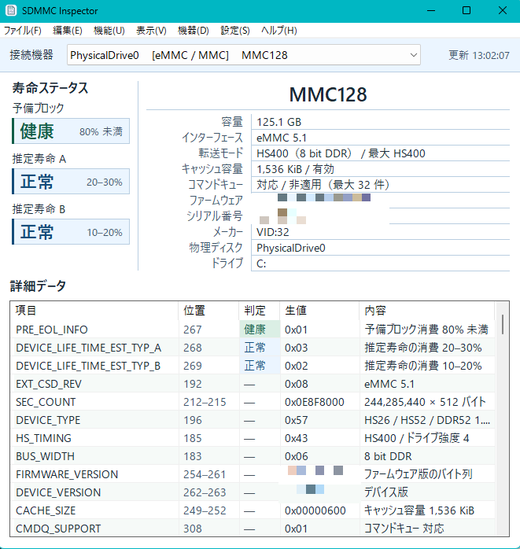

# SDMMC Inspector

Windows x64 で eMMC と SD の情報を確認できるツールです。対応する eMMC では、予備ブロックの状態と推定寿命 A・B を個別に表示します。

## 使い方

GUI を使うには、Windows x64 版の ZIP を展開し、`SDMMC-Inspector.exe` を起動してください。

画面上部から接続機器を選びます。機器をつなぎ直したときは **機能 → 再検出**（F5）、同じ機器を読み直すときは **機能 → 読み取り**（Ctrl+R）を使います。

コマンドラインで使う場合は、CLI 版の ZIP を展開し、`sdmmc_inspect_x64.exe` を起動してください。引数なしで起動すると対話メニューを表示します。引数の例は下の「コマンドラインから使う」にあります。

アクセスが拒否された場合は、管理者として起動してみてください。eMMC の寿命判定には eMMC 5.0 以降の対応機器が必要です。

SD のレジスタを読み取るには、Windows がネイティブ SD プロトコルを認識し、ドライバーが読み取りに対応している必要があります。一般的な USB カードリーダーでは、レジスタを取得できない場合があります。PCIe 接続のカードリーダーでも、取得できるかどうかは機器や Windows のドライバー、接続状態によって異なります。

画面の言語は初期状態で Windows の表示言語に従います。日本語の Windows では日本語、それ以外では英語で表示します。**設定 → 言語** から、日本語・英語を選べます。言語と自動更新の設定は次回起動時にも適用されます。

GUI の設定は、既定では `SDMMC-Inspector.exe` と同じフォルダーの `settings.json` に保存します。**設定 → 設定ファイルの保存先** から `%LOCALAPPDATA%\SDMMCInspector\settings.json` に切り替えられます。切り替えると現在の設定を選んだ場所に保存します。保存先の選択は、実行ファイルを同じフォルダーから起動したときに引き継がれます。

実行ファイルと同じフォルダーに保存するには、そのフォルダーへの書き込み権限が必要です。既定の場所に `settings.json` がない場合は、旧版で `%LOCALAPPDATA%\SDMMCInspector` に保存した設定を読み込みます。

## 保存と共有

| 操作 | メニュー |
| --- | --- |
| 取得した EXT_CSD をそのまま 512 バイトの `.bin` に保存 | **ファイル → EXT_CSD を書き出す（512 バイト）**（Ctrl+E） |
| 機器情報、寿命判定、レジスタの一覧をテキストに保存 | **ファイル → レポートを保存（テキスト）**（Ctrl+T） |
| 表示中の画面を PNG に保存 | **ファイル → 画面を保存（PNG）**（Ctrl+S） |
| レポートや選択したレジスタをコピー | **編集** メニュー |

**機器** メニューからも接続機器を切り替えられます。**機能** メニューから Windows のディスクの管理とデバイス マネージャーを開けます。

画面やレポートを共有する場合は、**表示 → シリアル番号を隠す** で機器情報のシリアル番号欄を非表示にできます。バイナリの書き出しには取得したレジスタの値をそのまま使います。

寿命判定と自動更新

推定寿命 A・B には、消費済みの範囲が 10% 刻みで記録されています。初期設定では範囲の上限が 60% 以下なら「正常」、80% 以下なら「注意」、それを超えて 100% 以下なら「警告」と表示します。例えば、50～60% は「正常」、60～70% は「注意」です。

| 推定寿命 A・B の判定 | レジスタの値 |
| --- | --- |
| 正常 | `0x01–0x06` |
| 注意 | `0x07–0x08` |
| 警告 | `0x09–0x0A` |
| 超過 | `0x0B` |
| 不明 | 未取得・未定義・予約値 |

**設定 → 寿命判定のしきい値** で、A・B 共通の「正常の上限」と「注意の上限」を 1～99% の整数で変更できます。正常の上限は注意の上限より小さくしてください。保存すると表示中のデータにも適用されます。

予備ブロックは `PRE_EOL_INFO` の値で判定します。`0x01` は「健康」、`0x02` は「注意」、`0x03` は「異常」です。未取得・未定義・予約値は「不明」と表示します。SD の寿命は、取得対象のレジスタからは判定できないため「不明」と表示します。 [eMMC の寿命情報（congatec）](https://www.congatec.com/fileadmin/user_upload/Documents/Application_Notes/AN50_eMMC_Lifetime.pdf)

**設定 → 自動更新** では、1 秒～24 時間のプリセットか、時・分・秒で指定する任意の間隔を選べます。初期状態では無効です。選択中のネイティブ SD/MMC 機器が対象で、前の読み取りが続いているときは、その回の更新を飛ばします。

機器情報とレジスタの見方

eMMC のファームウェア欄には `FIRMWARE_VERSION [254–261]` を表示します。文字列として読める値は文字列で、それ以外はレジスタのバイト順に 16 進数で表示します。eMMC の規格版はインターフェース欄で確認できます。その他の機器は、Windows が返す製品リビジョンをファームウェア欄に表示します。 [Windows の製品リビジョン情報](https://learn.microsoft.com/en-us/windows/win32/api/winioctl/ns-winioctl-storage_device_descriptor)

転送モードには現在の設定と最大対応モードを、キャッシュ容量には有効・無効を併記します。コマンドキューの欄では、対応と適用の有無、対応機器の最大件数を確認できます。

**詳細データ** には、取得した EXT_CSD から機器の規格版と対応機能に応じて読み取れる項目を表示します。未報告値や予約領域は省きます。表の行をダブルクリックすると、値や説明を全文で確認できます。**表示 → 生データ**（Ctrl+B）では 512 バイト全体を確認・コピーできます。

ネイティブ SD では **機能 → SD レジスタ読取（試験）** から SCR・SD Status・CMD6 のチェックモードを試せます。Windows のドライバーがこの読み取りに対応している必要があります。 [Windows の SD コマンド用 IOCTL](https://learn.microsoft.com/en-us/windows-hardware/drivers/ddi/sffdisk/ni-sffdisk-ioctl_sffdisk_device_command) [SD の公開簡易仕様](https://www.sdcard.org/downloads/pls/)

コマンドラインから使う

`sdmmc_inspect_x64.exe` を引数なしで起動すると、メニューから機器や読み取り方法を選べます。PowerShell などから引数で実行することもできます。

~~~powershell
.\sdmmc_inspect_x64.exe --help
.\sdmmc_inspect_x64.exe --list
.\sdmmc_inspect_x64.exe --auto
.\sdmmc_inspect_x64.exe --disk 0 --dump-prefix emmc0
.\sdmmc_inspect_x64.exe --volume E: --sd-probe --dump-prefix sd1
~~~

引数起動で `--dump-prefix` を指定すると、同じ名前のダンプファイルを上書きします。JSON 出力の `--json` とダンプの保存は別々に実行してください。

ソースからビルドする

.NET 10 x64 SDK と、Visual Studio の「C++ によるデスクトップ開発」ワークロード（MSVC と Windows SDK を含む）が必要です。x64 Developer PowerShell でリポジトリのフォルダーを開き、次を実行してください。 [Native AOT の前提条件](https://learn.microsoft.com/ja-jp/dotnet/core/deploying/native-aot/)

~~~powershell
.\build.ps1
~~~

`dist` に GUI 用の `SDMMC-Inspector.exe` と CLI 用の `sdmmc_inspect_x64.exe` が出力されます。GUI は C#・.NET 10 Native AOT でビルドし、C++17 の読み取り機能を静的リンクします。

## ライセンス

公開者は miniai-saka です。

SDMMC Inspector 本体は MIT ライセンスで配布します。 [MIT ライセンス全文](LICENSE)

GUI 版に含まれる .NET ランタイムのライセンスと第三者通知は、配布 ZIP の `dotnet-notices` に同梱しています。
